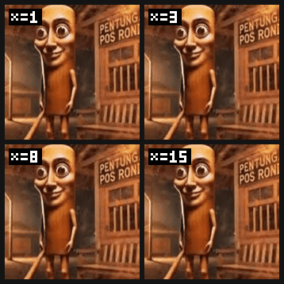
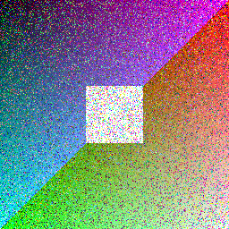
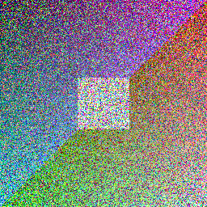
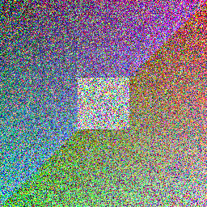

# decayfmt

[](https://github.com/aravpanwar/decayfmt/actions/workflows/ci.yml)
[](https://crates.io/crates/decayfmt)

_Featured in [This Week in Rust #660](https://this-week-in-rust.org/blog/2026/07/15/this-week-in-rust-660/)._

**A file format that corrupts itself a little every time you open it.** Every open
permanently damages the file on disk, with the amount determined by the filename.



Three file types:

- `.idcy<x>` for images (example: `photo.idcy3`)
- `.tdcy<x>` for text (example: `note.tdcy7`)
- `.adcy<x>` for audio (example: `clip.adcy5`)

`x` is a positive integer in the filename, the instability parameter. Higher `x` means
more corruption per open.

## Watch it decay

The grid above is one image encoded at `x=1`, `x=3`, `x=8`, and `x=15`, each opened the
same number of times. Same picture, four rates of decay. The examples below follow single
files across successive opens.

The clean original:


| Instability | After 1 open | After 3 opens |
| :---: | :---: | :---: |
| `x=3` (gentle) |  |  |
| `x=10` (severe) |  |  |

At `x=3` the image degrades gracefully over many opens. At `x=10` it is nearly gone after
one open and pure noise after three. `x` is the dial between a slow fade and near-instant
destruction.

Text decays the same way. A sentence encoded at `x=1` (a slow burn), printed after a few
opens:

```text
original : This sentence is dying, and every time you read it you kill it a little more.
 open 1  : This sgntence is d+ingd !nd every time you re&p it P~u kiKl it a little more}
 open 3  : This sgfxFn0e is d+ingd 3D6 every tibe you re&" it P~u kiKl it a 1ittl> m1re}
 open 6  : TIbm sgf}Fn0e ts d+iqgd yD6 ev*ry tibe you re&" )t Pnu kiKB )t aC1it"l> m1^e}
 open 9  : T/Sm sgf}Fk0- ts d|iqgd HD6 e@*rV tiFe you re&" )t Pnu kiKB )tpaC1it"lYMm1^>}
 open 12 : h/Sm hgf}Nk0-'ts?K|iqgd HD6 e@`~V}t&Fe y%u re&" )2 Pnu kiKB )6UaC1it1lYMm1]b!
```

Corruption only replaces bytes with printable characters, so the result degrades into
text-like noise.

## Scope

A corrupted file cannot be restored from its own contents. A copy made beforehand is
untouched, so keep a backup if you want the original. decayfmt makes no cryptographic
guarantee and is not a way to securely wipe a file.

## FAQ

A video sent a lot of people here at once, so here are the questions I keep getting.

**Does the file corrupt itself?**

The `open` command does it. It reads the bytes, damages some of them, writes them back, and
then shows you the result. Another program opening the same file leaves it untouched.

**Is this DRM? Could a company use it to make you re-buy games?**

No. A copy made before opening is unaffected, so the format cannot enforce one-time access to
the original. It also needs write access to the file it opens.

**Is it dangerous? Is it malware?**

It only touches files you encode into the decayfmt format and then open with decayfmt. It does
not scan your disk or run on its own.

**Can I get a decayed file back?**

Not from the file itself. Recovery requires a copy of an earlier version.

**Why does it exist?**

Mostly for fun. I liked the idea of a file you could use up, like a print left in the sun.

## Install

### With cargo

If you have a Rust toolchain, the quickest install is the published crate:

```
cargo install decayfmt
```

### From a release

Download the binary for your platform from the
[releases page](https://github.com/aravpanwar/decayfmt/releases) and put it on your PATH.
There is no runtime dependency to install.

On macOS the binary is unsigned, so the first run may be blocked by Gatekeeper. Right-click
it and choose Open, or clear the quarantine flag with `xattr -d com.apple.quarantine decayfmt`.

On Windows the released binary requires Windows 10 or later. Older versions fail to start
with a missing `api-ms-win-core-synch-l1-2-0.dll`.

### From source

Requires a Rust toolchain.

```
cargo build --release
```

The binary is produced at `target/release/decayfmt`.

## Quickstart

See it decay in your terminal, with no image or sample file needed:

```
echo "this sentence is about to start dying" > note.txt
decayfmt encode --input note.txt --output note.tdcy8
decayfmt open note.tdcy8
```

The instability `x` comes from the output name (`note.tdcy8` decays at `x=8`). Run
`decayfmt open note.tdcy8` a few more times to watch the sentence rot further on each open.
A high `x` like 8 garbles it fast; a low `x` like 1 is a slow burn over many opens.

On Windows PowerShell the `>` redirect writes UTF-16, which decayfmt refuses; create the
file with `Set-Content note.txt "this sentence is about to start dying"` instead. cmd.exe
and PowerShell 7 are fine with the line above.

## Usage

### Encode

Turn a source image, text, or audio file into a decayfmt file. Encoding does not modify the
source file and applies no corruption.

```
decayfmt encode --input photo.png --output photo.idcy3
decayfmt encode --input note.txt  --output note.tdcy7
decayfmt encode --input song.mp3  --output song.adcy5
```

Both the file type and the instability `x` come from the output name: `idcy` for images,
`tdcy` for text, and `adcy` for audio, followed by `x` as a positive integer
(`photo.idcy3` is an image at `x=3`).
Invalid output names are rejected before the file is written. Images are decoded to raw
RGBA; text must be valid UTF-8; audio (WAV, FLAC, MP3, OGG) is decoded to raw 16-bit PCM,
so an encoded audio file is much larger than a compressed source.

### Open

Open a decayfmt file. This corrupts it in place on disk, then displays the result.
Images open in your system's default image viewer. Text prints to the terminal, and
when there is no terminal (for example when launched from a file manager) it also
opens in your default text editor. Audio plays in your default audio player.

```
decayfmt open photo.idcy3
decayfmt open note.tdcy7
decayfmt open clip.adcy5
```

`x` is read from the filename, so renaming the file changes how hard the next open hits.

## As a library

The CLI is a thin layer over the `decayfmt` crate, which exposes the same format,
statistics, and errors to Rust code:

```rust
use decayfmt::corrupt::corrupt;
use decayfmt::format::FileType;

// Decay bytes in memory, no files involved.
let mut data = b"the quick brown fox jumps over the lazy dog".to_vec();
corrupt(&mut data, FileType::Text, 1.0);
```

`decayfmt::encode::encode_file` and `decayfmt::open::decay_in_place` are the encode and
open flows without the display step.

The Python package `decayfmt-py` is no longer maintained. Its final release, 0.2.1,
stays on [PyPI](https://pypi.org/project/decayfmt-py/) and reads files written by
decayfmt 0.2.

## Performance

Corruption was rewritten around bulk random draws and a parallel region split
(each region seeds its own OS-entropy generator), and encoding no longer builds a
second full-size buffer. Measured on an Apple silicon Mac (10 logical cores),
64 MiB payload, release build, `cargo bench --bench corrupt` / `--bench encode`:

| Scenario | Before | After | Speedup |
| :--- | ---: | ---: | ---: |
| text corruption, x=1 | 142 MiB/s | 1,366 MiB/s | 9.6x |
| text corruption, x=10 | 86 MiB/s | 754 MiB/s | 8.8x |
| image corruption, x=1 | 187 MiB/s | 1,421 MiB/s | 7.6x |
| image corruption, x=10 | 116 MiB/s | 950 MiB/s | 8.2x |
| encode 16 MiB image | 33.2 ms | 32.3 ms | ~1x |
| encode 16 MiB text | 7.9 ms | 3.9 ms | 2.0x |

The corruption loop itself is now bounded by entropy generation and memory
bandwidth rather than per-byte RNG calls. End-to-end encode is dominated by image
decoding and disk I/O, which the rewrite does not touch, so those numbers move
little. The same distribution holds: per-byte probabilities are quantized to
1/65536 granularity, about 1.5e-5 absolute error, far below anything a filename
`x` can distinguish, and the statistical test suite verifies it.

## How the corruption works

On each open, a per-byte corruption probability is derived from `x`:

```
p = 1 - exp(-x / 10)
```

So `x = 1` corrupts roughly 9.5% of eligible bytes per open, `x = 5` roughly 39%, and
`x = 10` roughly 63%. The randomness comes from a cryptographically secure generator
seeded from operating system entropy, never from a fixed seed, so two opens of the same
state look different and the corruption sequence cannot be replayed.

- **Images:** the red, green, and blue channels are each corrupted independently with
  probability `p`. The alpha channel is never touched, so corruption shows as color
  noise rather than transparency holes.
- **Text:** each byte is replaced, with probability `p`, by a random printable ASCII
  byte. This operates on bytes, not characters, so at high `x` it can break UTF-8; the
  viewer renders what it can and substitutes the replacement character for the rest.
  Corruption substitutes bytes in place and never inserts or deletes, so the file length
  and the positions of untouched bytes are preserved. At low `x` word lengths and layout
  largely survive. Spaces are replaced at the same rate as any other byte.
- **Audio:** each 16-bit sample is displaced, with probability `p`, by a random amount
  bounded by `x`. A sample is one value across two bytes, not two independent bytes, so
  replacing its bytes outright would throw it across the full range and a single such
  sample is heard as a click however gentle `x` is. Displacing it instead makes `x` mean
  roughly what it means for text and images: `x=1` is a faint grain that deepens over
  many opens, `x=10` buries the clip in noise on the first. Length is preserved, so the
  clip keeps its duration, sample rate, and channel count however far it rots.

## Guarantees

- Corruption is written to disk at open time, before display. A crash or kill after the
  write does not undo it.
- Opens of the same file are serialised with an advisory lock, so concurrent opens each
  cost their own corruption.
- Read-only files are rejected with an error, because open must modify the payload before
  displaying it.
- The header is never changed after encoding. Only the payload decays.
- There is no state in the file: no read counter, no timestamp, no record of who opened
  it or when.
- There is no recovery mechanism of any kind.

## Limitations

- A backup defeats the decay entirely, and a hex editor can tamper with the file.
- Displaying a file writes the corrupted result to a temporary file for the system
  viewer, which needs it to outlive the command. Every decayfmt run sweeps the ones left
  behind earlier, so the most recent display survives until the next run, or indefinitely
  if there is no next run.
- Images, text, and audio only. No video or other binary formats.

## License

decayfmt is released under the MIT License. See [LICENSE](LICENSE).

---

[HN Discussion](https://news.ycombinator.com/item?id=49390206)
